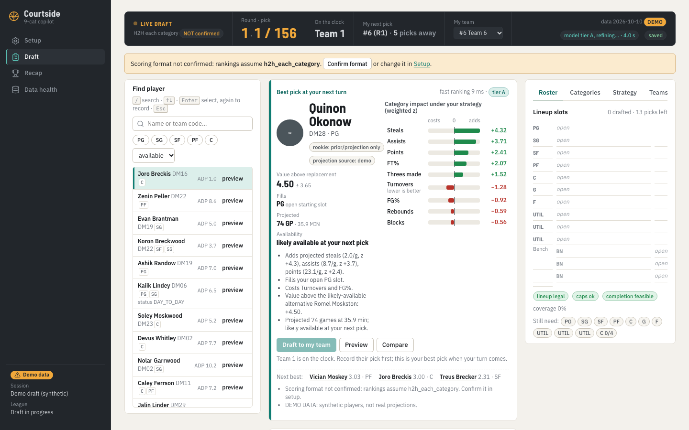
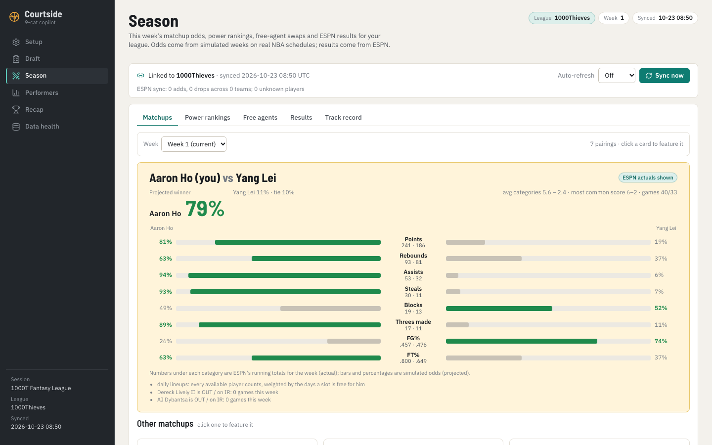
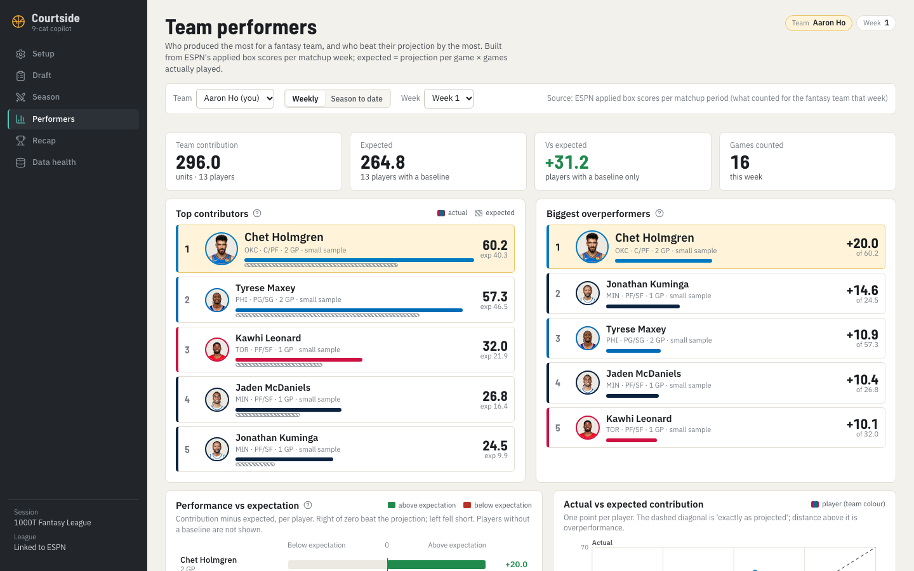

# ESPN 9-cat Draft Copilot

A side project for an ESPN nine-category fantasy basketball league: a draft assistant for draft night,
and an in-season companion afterwards. Runs entirely on your laptop (FastAPI + React), no accounts, no
ESPN credentials, and it never writes anything to ESPN.

## What it does

**Draft night.** Record picks as they happen and get a ranked, explained shortlist for your next pick:
who adds the most value above the player you could still get next turn, which lineup slot they fill,
what they add to each category, and how likely they are to be gone before you pick again. Projections
are built from ten seasons of NBA data (a learned model, validated on four held-out seasons, blended
with ESPN's published projections) and applied to the league's exact rules (ESPN eligibility, roster
slots, position caps, tie handling, punts). In paired mock drafts on past seasons the recommendations
beat ADP-style drafting by about half a category per weekly matchup.

**In season.** Link the session to your public ESPN league (read-only) and it keeps up by itself:

- **Season** tab: this week's matchups with per-category odds on the real NBA schedule (daily lineups
  modelled player by player), power rankings, free agents ranked for *your* roster with the cheapest
  drop, ESPN's live results, and a frozen weekly projection log scored against actual winners.
- **Performers** tab: for any team, who contributed most to its actual results and who beat their
  projection by the most, per week or season to date, built from ESPN's applied box scores.
- A week-by-week actual-vs-projection tracker you can plot (`make performance`).

## Screens





One workspace: charcoal sidebar, warm canvas, teal for actions, amber for what is yours, green/red
only for favoured/unfavoured and over/under expectation, NBA team colours for players. Every chart
prints its values; projections are grey or hatched, ESPN actuals are solid; demo data is labelled.

## Running it

```
make install        # uv sync (backend) + npm ci (frontend)
make demo           # a session on the synthetic 600-player demo league
make dev            # backend :8000 + frontend :5173 (BACKEND_PORT=... FRONTEND_PORT=... to override)
make refresh        # real data: nba_api + ESPN public endpoints (no cookies)
make build-snapshot # projections + eligibility + ADP -> data/nba/snapshots/

make link SESSION=<id> LEAGUE=<espn league id>   # map managers to your ESPN league
make sync SESSION=<id>                            # pull rosters, matchups, transactions, box scores
make season SESSION=<id>                          # print this week's pairings, odds, results, power
make performance SESSION=<id>                     # actual-vs-projection tracker + free-agent hot starts

make test           # pytest + vitest + tsc;  make e2e = Playwright
make bench / make validate / make evaluate / make research
```

Your ESPN league must be set to "viewable to public" (League > Settings > Basic Settings) for the link;
nothing else is needed. Real data under `data/nba/` and local exports are git-ignored.

## Docs

`CLAUDE.md` (invariants, resume protocol) · `docs/USER_GUIDE.md` (draft day and in-season workflow)
· `docs/DATA_SOURCES.md` · `docs/MODEL_CARD.md` · `docs/DECISIONS.md` (DEC-01..30) ·
`docs/DRAFT_COPILOT_PLAN.md` · `docs/PROGRESS.md` · `docs/EVALUATION.md`, `docs/VALIDATION.md`,
`docs/BENCHMARKS.md` (measured results).
